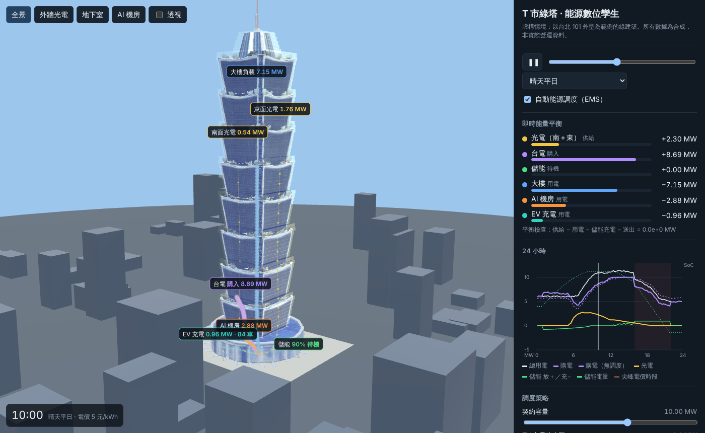

# bapoc：T 市綠塔能源數位孿生

**[線上 demo](https://clarencechien.github.io/bapoc/)**（GitHub Pages）

虛構情境：假設台北 101 是 T 市的一棟綠建築，南、東兩面換成半透明光電玻璃，地下室有儲能與 AI 機房，停車場有電動車充電樁。瀏覽器裡的 3D 數位孿生可以看能量的進出、透視大樓、點設備看數據，並調整調度策略看能量如何重新平衡。所有數據都是合成的。



- [企劃](docs/PLAN.md)：目標、虛構設定、系統架構、EMS 規則、階段與風險。
- [3D 素材](docs/ASSETS.md)：Gemini 生成設計圖、TRELLIS.2 轉 3D 的做法、結果與重現指令。

## 功能

- 綠塔、儲能機櫃、充電樁、AI 機櫃都是 TRELLIS.2 生成的模型。
- 透視模式：外牆變半透明，看見樓板、核心筒、地下室的儲能、AI 機房與停車場。
- 能量流動畫：光電、台電、儲能流向主配電盤，再流向大樓、AI 機房與充電樁；點數與速度隨功率變化。
- 24 小時合成數據（15 分鐘一步），五種情境：晴天平日、多雲平日、颱風停班日、晴天假日、需量反應事件。
- 規則式 EMS：削峰守契約容量、尖峰電價時段儲能放電、AI 訓練與 EV 充電移到便宜時段、需量反應時全力降載。可關閉 EMS 與「無調度」對照。
- 可調整：契約容量、EV 充電總上限、AI 可延後比例、儲能保留電量；KPI 即時重算。
- 每一步都檢查能量守恆（供給＝用電＋儲能充電＋送出）。

## 開發

```sh
npm ci
npm run dev      # http://localhost:5173/bapoc/
npm test         # 合成數據與 EMS：能量守恆、SoC 範圍、可重現、EMS 削峰、需量反應
npm run build
node tools/screenshot.mjs http://localhost:5173/bapoc/ out.png overview 10   # 無頭瀏覽器截圖
```

`main` 的 push 會由 GitHub Actions 建置並部署到 Pages（需在 repo 設定 Pages Source 為 GitHub Actions）。
