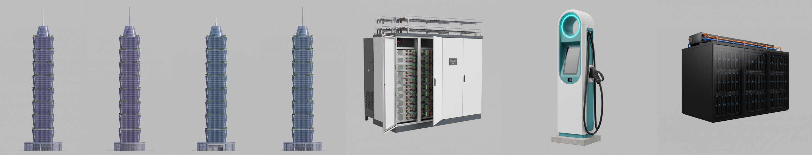
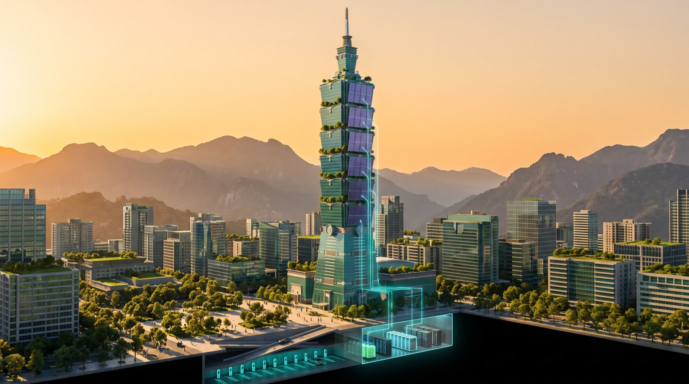
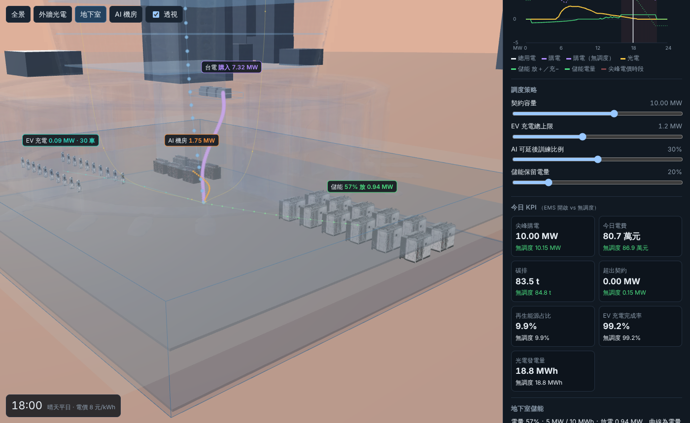

# 3D 素材：Gemini mockup → TRELLIS.2

第一批素材（2026-10-20）：綠塔本體四立面，以及儲能機櫃、充電樁、AI 機櫃三種設備。全部由 Gemini 3 Pro Image（Nano Banana Pro）生成設計圖，再用 TRELLIS.2 在 Modal H100 上轉成 3D。

## 設計圖



左起：南（光電）、東（光電）、北（一般玻璃）、西（一般玻璃）、儲能機櫃、充電樁、AI 機櫃。原圖在 [assets/mockups/](../assets/mockups/)，提示全文在 [prompts.json](../assets/mockups/prompts.json)。

- 先畫南立面，再以它為參考圖畫其他三面，四張的高度、節數、頂冠與尖塔完全一致（塔身在每張圖的同一列寬度都是 580–956 px），可以直接拿來做四視圖拼接。
- 灰底（#BFBFBF）、正交、平光的提示寫法沿用 yukimura。
- 每張約 20–28 秒。

另有一張鳥瞰概念圖，不轉 3D，作為場景與敘事的參考：



## 轉 3D

| 素材 | 輸入 | 實際解析度 | 推論 | 函式總時間 | 原始三角面 |
| --- | --- | ---: | ---: | ---: | ---: |
| 綠塔 seed 7（採用） | 四視圖拼接 | 1536 | 191 秒 | 388 秒 | 6.3 M |
| 綠塔 seed 23 | 四視圖拼接 | 1536 | 183 秒 | 312 秒 | 10.2 M |
| 儲能機櫃 | 單圖 | 1152 | 155 秒 | 289 秒 | 50.2 M |
| 充電樁 | 單圖 | 1536 | 146 秒 | 253 秒 | 14.2 M |
| AI 機櫃 | 單圖 | 1536 | 187 秒 | 311 秒 | 40.6 M |

紀錄在 [generation/](generation/)。所有工作在 Modal 上並行跑，牆鐘時間約 7 分鐘。

**四視圖拼接**沿用 yukimura 移植自 ComfyUI-Trellis2 的做法（[tools/trellis_modal.py](../tools/trellis_modal.py)）：正面＝南、左＝東（站在南面看，東在右手邊，也就是建築物自己的左側）、背面＝北、右＝西。四面各自有圖，所以不需要鏡像。實測稀疏結構範圍 x 9、y 9、z 31，高度方向最長，與輸入一致。

**網頁用壓縮**：綠塔 Draco + WebP 2048 貼圖，58 MB → 4.4 MB；設備另外簡化到約 12%、貼圖 1024，每個約 0.8–1.2 MB。

## 結果




- **綠塔**：八節堆疊、每節外擴、節間的綠化平台、頂冠與尖塔都保留下來；南、東兩面是深藍紫光電玻璃，北、西兩面是藍綠玻璃，四視圖確實讓每一面照自己的圖長。帷幕格線在近看時有些糊、轉角不夠銳利，和 yukimura 看到的「融化」一樣，但在全景距離可以接受。
- **seed 比較**：seed 23 的裙樓出現粉紅色貼圖雜斑，seed 7 乾淨，採用 seed 7。
- **設備**：三種設備一眼可以認出來（儲能機櫃的開門與電池模組、充電樁的 LED 環與槍線、AI 機櫃的冷卻管）。單圖生成，背面是推測的，但在地下室視角看不到背面，不影響。
- **數據疊加不用生成模型**：樓板、核心筒、光電外皮的發光層、地下室結構和能量路徑都是依綠塔網格量測出的寬度剖面，由 three.js 程序化產生，才能準確對位。

## 重現

```sh
python3 tools/gen_image.py --prompt-file prompts/tower-south.txt --output assets/mockups/tower-south.png
python3 tools/gen_image.py --ref assets/mockups/tower-south.png --prompt-file prompts/tower-north.txt --output assets/mockups/tower-north.png
# 東、西與設備同理，設備用 --aspect 1:1
python3 tools/key_views.py assets/mockups/tower-*.png --cut-below 2668      # 去背，並去掉圖底的地平線
python3 tools/key_views.py assets/mockups/prop-*.png
python3 tools/run_trellis.py --name tower --seeds 7,23 \
  --views front=assets/inputs/tower-south.png,left=assets/inputs/tower-east.png,back=assets/inputs/tower-north.png,right=assets/inputs/tower-west.png
python3 tools/run_trellis.py --name prop-bess --views front=assets/inputs/prop-bess.png --faces 120000 --texture 2048
npx @gltf-transform/cli@4.1.1 optimize .tmp/trellis/tower-seed-7/tower.glb public/models/tower.glb \
  --compress draco --texture-compress webp --texture-size 2048 --simplify false
npx @gltf-transform/cli@4.1.1 optimize .tmp/trellis/prop-bess-seed-7/prop-bess.glb public/models/bess.glb \
  --compress draco --texture-compress webp --texture-size 1024 --simplify true --simplify-ratio 0.12 --simplify-error 0.002
```

- 金鑰從環境變數讀取：Gemini 用 `gemini_key`；Modal 用 `modal`／`modal_secret`（或 `modal_token_id`／`modal_token_secret`）。不要寫進程式、前端、Git 或文件。
- TRELLIS.2 的 CUDA 映像、權重快取和 Hugging Face Secret（`trellis-huggingface`，DINOv3 gated model）都沿用 yukimura 已驗證的設定；結果存在 Modal Volume `yukimura-trellis2-cache` 的 `results/bapoc/`，未壓縮原檔可用 `--download-only` 取回。
- `pip install 'modal[api-proxy-support]==1.6.1' 'truststore==0.10.5' scipy pillow numpy`

## 授權

TRELLIS.2 為 MIT 授權（Microsoft），DINOv3 另有 gated 模型授權。多視角取樣做法來自 [visualbruno/ComfyUI-Trellis2](https://github.com/visualbruno/ComfyUI-Trellis2)（MIT）。設計圖由 Gemini 依本專案提示生成；建築外型參考台北 101 的輪廓語彙，本 demo 為虛構情境。
